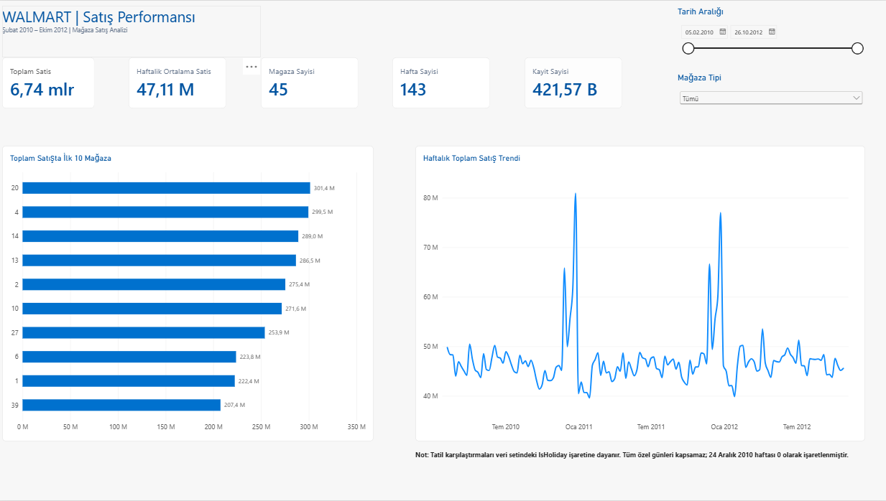
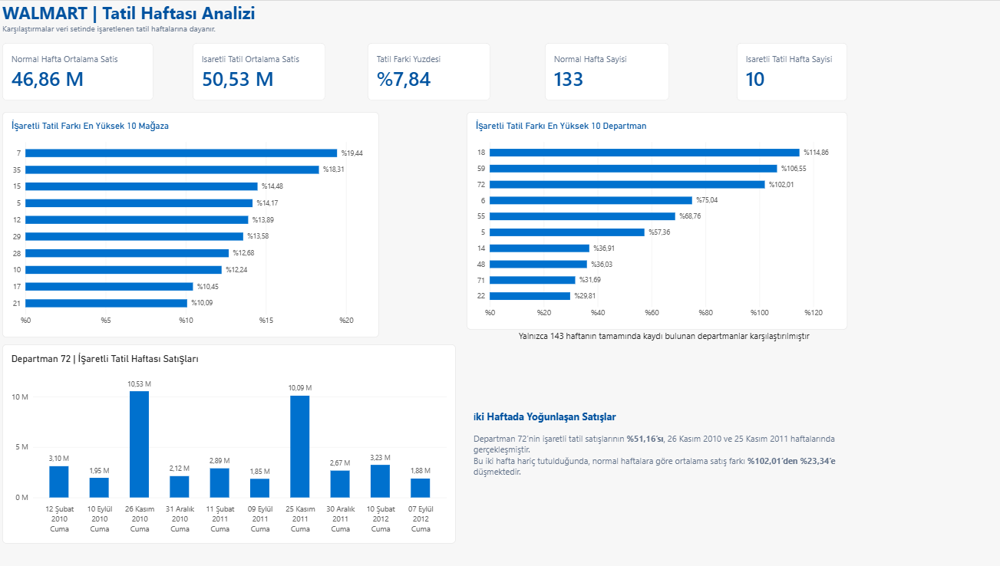

# Walmart Satış Performansı ve Tatil Haftası Analizi

SQL Server, Power BI ve Python kullanarak Walmart mağazalarının satış
performansını, haftalık satış trendlerini ve işaretli tatil haftalarındaki
satış farklılıklarını incelediğim veri analizi projesi.

## Veri Kaynağı

[Kaggle — Walmart Recruiting: Store Sales Forecasting](https://www.kaggle.com/competitions/walmart-recruiting-store-sales-forecasting/data)

- Dönem: 5 Şubat 2010 – 26 Ekim 2012
- 45 mağaza ve 81 farklı departman
- 143 hafta
- 421.570 mağaza-departman-hafta satış kaydı
- Kaynak dosyalar: train.csv, stores.csv ve features.csv

Ham veri dosyaları bu depoya eklenmemiştir.
Veriler, Kaggle üzerindeki erişim ve kullanım koşulları kapsamında edinilebilir.
Bu çalışma bağımsız bir portföy projesidir; Walmart ile kurumsal bir bağlantısı yoktur.

## Kullanılan Araçlar

- SQL Server: Veri hazırlama, kontroller, JOIN, CTE ve pencere fonksiyonları
- Power BI: Etkileşimli raporlar, filtreler ve DAX ölçüleri
- Python / pandas: Veri kontrolü, birleştirme ve analiz
- matplotlib: Grafik oluşturma

## Analiz Süreci

1. CSV dosyalarının veri tiplerini ve ondalık değerlerini kontrol ettim.
2. Eksik değerleri ve tekrar eden anahtarları inceledim.
3. Satışları mağaza ve haftalık ek bilgilerle birleştirdim.
4. Birleştirmede kayıt kaybı veya satır çoğalması olmadığını kontrol ettim.
5. Mağaza performansını, zaman içindeki değişimi ve tatil farklarını analiz ettim.
6. Temel sonuçları SQL, Power BI ve pandas arasında karşılaştırdım.

## Öne Çıkan Bulgular

- Toplam satış tutarı: **6.737.218.987,11**
- Toplam satış lideri: **Mağaza 20**, yaklaşık **301,4 milyon**
- Büyüklük birimi başına haftalık satış lideri: **Mağaza 43**
- En yüksek haftalık toplam satışın kayıt tarihi: **24 Aralık 2010**
- İşaretli tatil haftalarının ortalama satışı, diğer haftalardan **%7,84** yüksek.
- Departman 72'nin işaretli tatil satışlarının **%51,16'sı**,
  26 Kasım 2010 ve 25 Kasım 2011 haftalarında yoğunlaşıyor.
- Bu iki hafta hariç tutulduğunda departman 72'nin normal haftalara göre
  ortalama satış farkı **%102,01'den %23,34'e** geriliyor.

## Power BI Raporları

### Genel Bakış

Tarih ve mağaza tipi filtreleriyle satış göstergeleri,
ilk 10 mağaza ve haftalık satış trendi.

### Tatil Haftası Analizi

Normal ve işaretli tatil haftalarının karşılaştırılması,
mağaza ve departman sıralamaları ve departman 72 incelemesi.

## Proje Dosyaları

- [SQL analiz sorguları](Walmart_Analiz.sql)
- [Power BI için SQL görünümü](Walmart_PowerBI_View.sql)
- [Python notebook](Walmart_Analizi.ipynb)
- [HTML analiz raporu](Walmart_Analizi.html)

HTML raporunu görüntülemek için dosyayı indirip tarayıcıda açabilirsiniz.

## Python Çalışmasını Tekrar Çalıştırma

Gerekli paketler:

    python -m pip install pandas matplotlib jupyterlab

Notebook'u bir proje klasörüne indirin. Aynı klasörde `data` adlı
bir alt klasör oluşturup Kaggle'dan alınan şu dosyaları yerleştirin:

- data/train.csv
- data/stores.csv
- data/features.csv

JupyterLab'ı bu proje klasöründen başlatın:

    python -m jupyterlab

Notebook'u açıp hücreleri yukarıdan aşağıya çalıştırın.
Grafikler, çalışma klasöründeki `grafikler` alt klasörüne kaydedilir.

## Veri Kalitesi ve Sınırlamalar

- MarkDown alanlarında eksikler bulunmaktadır; otomatik olarak sıfırla doldurulmamıştır.
- 1.285 negatif satış kaydı korunmuştur. Toplam tutarları −88.161,56'dır.
  Bu kayıtların nedenleri kesin olarak bilinmemektedir.
- IsHoliday alanı bütün özel günleri kapsamaz.
  Örneğin 24 Aralık 2010 haftası False olarak işaretlenmiştir.
- Departman numaralarının ürün kategorisi karşılıkları bilinmemektedir.
- Departman 72'de haftalara göre kayıt bulunan mağaza sayısı 41–43 arasında değişmektedir.
- Departman yüzde sıralamasında 133 normal ve 10 işaretli tatil haftasında
  kaydı bulunan departmanlar kullanılmıştır.
- Veri 2010 ve 2012 yıllarının tamamını kapsamaz.
- Karşılaştırmalar nedensellik veya kârlılık göstermez.

- - [Power BI raporunu indir](Walmart_Dashboard.pbix)

Power BI raporu, Power BI Desktop ile açılabilir.
Veri yenilemek için SQL Server bağlantısı kendi ortamınıza göre
düzenlenmeli ve gerekli tablolar ile görünüm hazırlanmalıdır.
